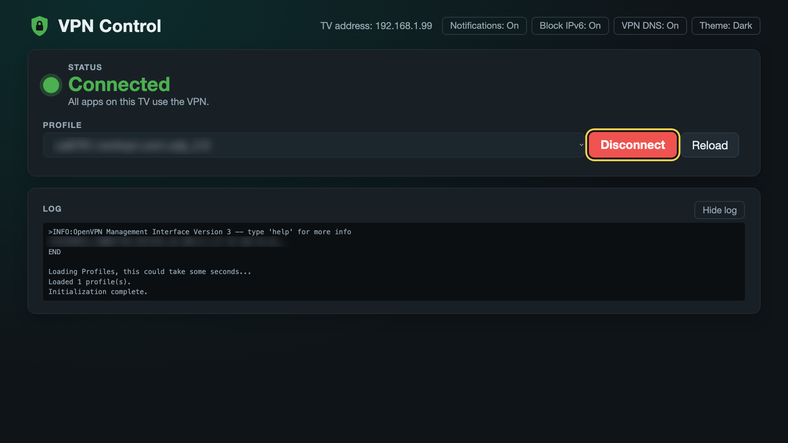

# lgtv-vpn
A small LG webOS TV app that wraps an OpenVPN client so you can start and stop VPN connections directly from your TV without an external router or device.



## What the app does
- Uses the bundled OpenVPN binary to start a VPN connection on your LG TV.
- Talks to the Homebrew Channel service to run OpenVPN in the background and manage its lifecycle.
- Provides an on-device UI built for the remote to connect, disconnect, and view connection status.
- The VPN connection is kept even when switching apps. So Youtube / Netflix etc. is also running through the VPN connection.
- Shows a TV notification when the VPN connects, disconnects, or loses its connection and reconnects, even while you're in another app. OpenVPN runs `res/vpn-hook.sh` for this (`--up`/`--down`).
- Blocks IPv6 while the VPN is up, so apps like YouTube and Netflix cannot go around an IPv4-only VPN; it is restored on disconnect.
- Uses the DNS servers the VPN pushes while it is up. The TV's own resolver otherwise keeps asking your router, outside the tunnel, which reveals what you look up and can make streaming services pick servers for your real location. The hook points `/etc/resolv.conf` at the VPN's servers and restores it on disconnect.
- Each can be switched off with **Notifications**, **Block IPv6** and **VPN DNS** in the top bar; changes apply right away, even while connected.

## Using the app
The screen fits on the TV without scrolling and is navigated with the remote's arrow keys and OK button.

- **Shield** (next to the title): green with a closed padlock while connected, amber while connecting, grey with an open padlock otherwise.
- **Status** (top left): a colored dot and label show Connected (green), Connecting… (amber), Sign-in needed, or Disconnected (red).
- **Profile** (below the status): pick a profile, then press **Connect**; the button turns into a red **Disconnect** while the VPN is up. **Reload** re-reads the profiles folder, so new profiles show up without restarting the app.
- **Sign-in** (in place of the profile row): appears when a profile asks for a username and password or a key passphrase. See [Profiles that need a password](#profiles-that-need-a-password).
- **Log** (bottom left): OpenVPN and app messages, newest at the bottom. **Hide log** folds it away.
- **Add a VPN profile** (right): shown while no profiles are found, or when you pick **+ Add a profile…** at the end of the profile list (press **Close** to hide it again). It lists the setup steps with a ready-to-paste `scp` command that includes the TV's IP address and profiles folder.
- **Notifications / Block IPv6 / VPN DNS** (top right): turn the connect/disconnect notifications, the IPv6 block and the VPN's DNS servers on or off. All start on.
- **Theme** (top right): cycles through Dark, Light, Midnight and OLED Black. The choice is remembered.


## Installation options
### Install a published IPK
1. Download the latest `com.sk.app.lgtv-vpn_*.ipk` from the project releases.
2. Install the IPK via `ares-install` or with the [webOS Dev Manager](https://github.com/webosbrew/dev-manager-desktop).

### Build the IPK yourself
1. Install the webOS TV CLI so you have access to `ares-package` and `ares-install`.
2. From the repository root, run:
   ```bash
   ares-package com.sk.app.lgtv-vpn
   ```
   This produces an IPK file such as `com.sk.app.lgtv-vpn_0.0.1_all.ipk` in the current directory.
3. Deploy the generated IPK to your TV:
   ```bash
   ares-install com.sk.app.lgtv-vpn_0.0.1_all.ipk
   ```

### Install this checkout next to the released app
With the SSH server enabled in the Homebrew Channel settings:
```bash
./install-to-tv.sh <tv-ip> [profile.ovpn ...]
```
This builds an IPK with the app id `com.sk.app.lgtv-vpn.dev` ("VPN (dev)") and installs it alongside the released app, so you can try changes without touching it. It copies the released app's profiles on the first install. Running it again updates the dev app and keeps its profiles. Set `APP_ID` and `APP_TITLE` to use another id and name. No webOS SDK is needed.

Both apps control OpenVPN through the same management port, so they see and control the same connection; only run one VPN at a time.

### Build the OpenVPN binary
`res/openvpn` is built from the official sources by a script, so it can be rebuilt and checked:
```bash
./build-openvpn.sh
```
It needs Podman or Docker and nothing else. In a pinned Alpine image it downloads OpenVPN, OpenSSL, LZO, LZ4 and libcap-ng, checks each against the SHA-256 pinned in `openvpn-build/build.sh`, and cross-compiles a static 32-bit ARMv7 binary with Zig's C compiler (musl, so it doesn't depend on the TV's libraries). The versions and the binary's own SHA-256 are written to `openvpn-build/BUILDINFO`; building again gives the same binary, so anyone can compare it with the one in the repo.

## Provide your VPN profiles
The app expects your OpenVPN profiles to live in `/media/developer/apps/usr/palm/applications/com.sk.app.lgtv-vpn/profiles` on the TV:
1. Copy your `.ovpn` files (and any referenced certificates/keys) into that folder (possible also with [webOS Dev Manager](https://github.com/webosbrew/dev-manager-desktop)).
2. Launch the app and select the desired profile from the drop-down list, then press **Connect**.

From a checkout of this repository, `copy-profile.sh` does this over SSH (enable the SSH server in the Homebrew Channel settings first):
```bash
./copy-profile.sh <tv-ip> ~/Downloads/my-vpn.ovpn [more.ovpn ...]
```
It also copies files the profile references (`ca`, `cert`, `key`, `tls-auth`, `auth-user-pass`, ...) when they sit next to it, then reopens the app so the new profiles are listed. Profiles go to the dev build when it is installed, otherwise to the released app; set `APP_ID=com.sk.app.lgtv-vpn` to choose the released app. The IP can also come from `TV_IP`.

If the app finds no profiles, it shows these steps along with a ready-to-paste `scp` command for your TV (enable the SSH server in the Homebrew Channel settings first). Press **Reload** after copying. The dev build installed by `install-to-tv.sh` has its own folder, `.../com.sk.app.lgtv-vpn.dev/profiles`, and its setup steps show that path.

Relative paths in a profile (`ca`, `cert`, `key`, `auth-user-pass` files) are resolved against the profiles folder.

### Profiles that need a password
If a profile asks for a username and password (`auth-user-pass`) or has an encrypted private key, the app shows a sign-in form when you connect. A wrong password brings the form back. To avoid typing on the TV, put the login in a plain text file in the profiles folder and reference it from the profile:
```
auth-user-pass login.txt
```
The file has exactly two lines, the username first and the password second, with nothing else around them (no labels or quotes):
```
my-vpn-username
my-vpn-password
```

`copy-login.sh` does this for a profile that is already on the TV:
```bash
./copy-login.sh <tv-ip> my-vpn.ovpn [login.txt]
```
`login.txt` uses the two-line format above. Without it, the script asks for the username and password and sends them straight to the TV, so they aren't saved on your computer. The login is stored next to the profile as `my-vpn.login`, readable by root only, and the profile's `auth-user-pass` line is pointed at it. Some providers (NordVPN, for example) use separate "service credentials" for this rather than your account login.

## Requirements
- An LG TV with webOS that has the Homebrew Channel with root installed and running.
- Valid OpenVPN configuration files that work with your VPN provider.

## Stability and troubleshooting
- The app is still experimental and may not be fully stable yet. If it becomes unresponsive, restart the TV with QuickStart disabled.
- You can terminate any leftover OpenVPN processes through the root shell on the TV if a restart is not possible.
